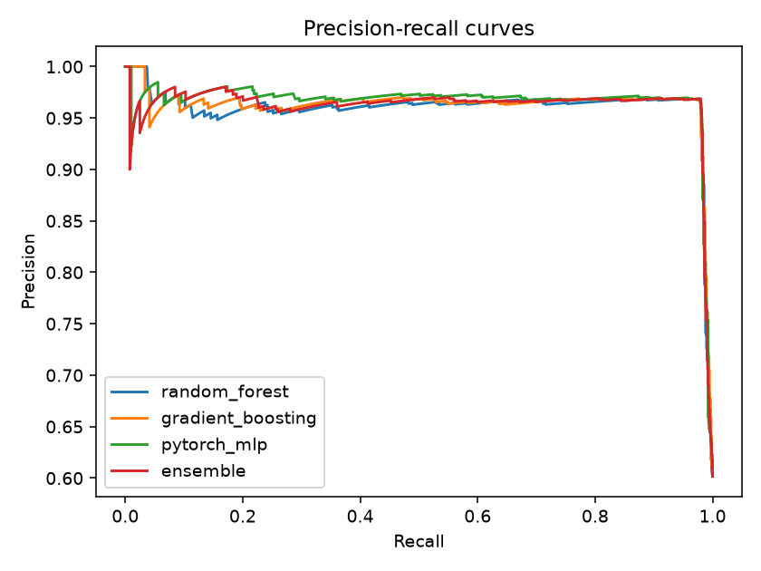

# ML-Based Phishing URL Detection

A classifier that looks at a URL, and only the URL, and decides whether it is probably phishing. I built it to see how far plain text features can go without fetching the page, doing WHOIS lookups or touching the network at all.

It ships with a small web app (PhishLens) for checking links by hand, and a command-line scanner that can run from cron and flag suspicious URLs out of a feed.


## What's in it

- 38 hand-written features pulled from the URL string: length, digit ratio, entropy, subdomain depth, IP hosts, `@` tricks, punycode, suspicious TLDs and more
- Three supervised models on those features: Random Forest, Gradient Boosting and a small PyTorch MLP
- An Isolation Forest trained only on legitimate URLs, used as a "does this look unusual" check
- An ensemble that averages the three supervised models
- `scan_urls.py` for batch and watch-mode scanning, with a non-zero exit code when something is flagged
- A FastAPI backend, a plain HTML/CSS/JS front end, and an API test suite

Stack: Python, scikit-learn, PyTorch, pandas, NumPy, FastAPI.

## Why URL-only

Most phishing detectors that score well lean on page content, certificate data or domain age. Those signals are strong, but each one costs a request per link, and you have to visit a possibly hostile site to get it. A URL-only model is cheap enough to run on every link in a mail gateway or proxy log, and it never opens anything. The trade-off is that it will miss phishing hosted on a clean-looking domain, and I would rather say that up front than hide it.

## How it works

**Features** (`src/features.py`). Three groups: whole-URL measures (length, special characters, entropy, bait words like `login` or `verify`), path and query measures (depth, parameter count, executable extensions), and host measures (raw IP instead of a name, subdomain count, hyphens, TLD, link shorteners, a brand name sitting in a subdomain). Nothing resolves DNS, so extraction is deterministic and takes well under a millisecond per link.

**Models.** I trained three different families on purpose. Tree models are strong on tabular data like this, the neural net makes a different kind of mistake, and averaging them smooths out each one's errors. The MLP has two hidden layers with batch norm, dropout and early stopping on a validation split. It is wrapped in a scikit-learn style class (`src/nn.py`) so it saves and scores the same way as the others.

**Anomaly detection.** The Isolation Forest never sees a phishing example. It learns what ordinary legitimate URLs look like and scores how far a new one sits from that. On its own it is clearly weaker than the supervised models, but it works as a second opinion and it is the only part that could catch a pattern the training labels never covered.

**Choosing a threshold.** The default alert cut-off is 0.5. For analysts who would rather see fewer false alarms, `train.py` also finds the lowest score on the test set that keeps precision at 98% or higher. The app and the scanner expose it as Strict mode.

## Results

| Model             | Precision | Recall | F1    | ROC-AUC |
| ----------------- | --------- | ------ | ----- | ------- |
| Random Forest     | 0.968     | 0.979  | 0.974 | 0.963   |
| Gradient Boosting | 0.968     | 0.977  | 0.972 | 0.966   |
| PyTorch MLP       | 0.967     | 0.979  | 0.973 | 0.967   |
| Ensemble (mean)   | 0.967     | 0.979  | 0.973 | 0.965   |
| Isolation Forest  | 0.890     | 0.899  | 0.894 | 0.925   |

Stratified 80/20 split, scored on the held-out 20%. Five-fold cross-validated F1 is 0.975 for Random Forest and 0.973 for Gradient Boosting, so the split is not a lucky one.



These numbers come from the generated dataset the repo falls back to when there is no `data/urls.csv` (about 9.7k URLs, with 3% of the labels deliberately flipped to imitate noisy feeds). That noise caps accuracy near 97%, which is why every model lands in the same place. Read the table as proof that the pipeline works end to end, not as a claim about real-world accuracy. Add a real dataset (below) and re-run `python train.py` to get numbers that mean something.

The other charts are in `reports/`: confusion matrices for each model and the Random Forest's top features.

## Running it

You need Python 3.10 or newer.

```bash
git clone https://github.com/Pk-webTech/ML-Based-Phishing-URL-Detection-
cd ML-Based-Phishing-URL-Detection-
python -m venv venv
venv\Scripts\activate          # macOS/Linux: source venv/bin/activate
pip install -r requirements.txt
python train.py                # trains, then writes models/ and reports/
python app.py                  # serves http://127.0.0.1:8000
```

Trained models are not committed, so run `python train.py` before the app or the scanner. On Windows, `run_app.bat` does the whole setup, trains if needed and opens the browser.

### Using real data

`train.py` reads `data/urls.csv` if it exists. It needs two columns: `url` and `label` (1 for phishing, 0 for legitimate). Phishing URLs are available from PhishTank and OpenPhish, and the Tranco list works for legitimate ones. Without the file it uses the generated data, and the Model tab in the app says so.

### Command-line scanner

```bash
python scan_urls.py --input urls.txt --output flagged.csv
python scan_urls.py --input urls.txt --strict
python scan_urls.py --input urls.txt --watch 60     # re-scan every minute, new URLs only
```

Input can be a text file with one URL per line, a CSV with a `url` column, or `-` for stdin. Each flagged link gets a score and a HIGH, MEDIUM or LOW label. The exit code is 1 when anything was flagged, so it can gate a script.

## The web app

The Check tab splits a link into protocol, subdomain, main domain, path and query, underlines each part by how risky it looks, and gives a one-line reason for each. Next to that it lists the warning signs it found and shows how each model voted, so you can see when they disagree. Bulk scan takes up to 1,000 links, pasted or uploaded, with sorting, filtering and CSV export. History and Model tabs round it out.

A few choices worth mentioning:

- The server never opens or resolves a submitted link. It only reads the text.
- Inputs are length-limited and validated, API calls are rate limited, and responses carry a strict Content-Security-Policy.
- CSV exports neutralise cells that start with `=`, `+`, `-` or `@`, so a hostile URL cannot turn into a spreadsheet formula.
- "Copy safe version" turns `https://example.com` into `hxxps://example[.]com` for pasting into tickets and chat.
- It binds to 127.0.0.1 by default. If you expose it, put it behind a TLS reverse proxy.

## Tests

```bash
python -m pytest -q
```

The suite covers the API (valid and invalid input, batch limits, rate limiting, security headers, the image whitelist) and the URL parsing behind the explanations. It needs the models, so train first.

## Project layout

```
train.py             training and evaluation
scan_urls.py         command-line scanner
app.py               FastAPI app
src/features.py      feature extraction
src/nn.py            PyTorch classifier
src/explain.py       URL breakdown and plain-language warning signs
src/predictor.py     model loading and scoring for the app
src/data.py         dataset loading and the generated fallback data
static/              front end (HTML, CSS, JS, no build step)
tests/               API and parsing tests
reports/             metrics and charts from the last training run
```

## Limitations

- URL-only means a phishing page on a clean, freshly registered domain with a plausible path can look normal. Domain age, certificate data and page content would catch more.
- Brand lookalikes are matched against a short built-in list, not a real brand database.
- The models are trained on one snapshot. Phishing patterns drift, so a real deployment would retrain on fresh feeds.
- A flagged link is a lead for a person to look at, not a verdict.

## What I would do next

Add optional live lookups (domain age, DNS, certificate) behind a flag, try a character-level model on the raw URL string alongside the hand-built features, and evaluate on a time-based split of real feeds instead of a random one, since that is closer to how the model would be used.

---

Built by Piyush ([@Pk-webTech](https://github.com/Pk-webTech)).
